---

## 🇹🇷 Merhaba, ben Yunus! / 🇬🇧 Hi, I'm Yunus!

<table><tr><td width="50%" valign="top">

**🇹🇷 Türkçe**

Laravel ve PHP ağırlıklı çalışan, SaaS platformları, rezervasyon sistemleri, biletleme çözümleri, finansal otomasyonlar ve mobil uygulamalar geliştiren bir yazılım geliştiriciyim. Çok kiracılı mimariler, API entegrasyonları, performans ve güvenli yazılım geliştirmeyle ilgileniyorum.

- 🔭 Odak: **Açık kaynak projeler ve geliştirici araçları**
- ⚙️ İlgi alanları: **SaaS, multi-tenancy, otomasyon**
- 🛡️ Teknik ilgi: **Siber güvenlik ve dijital adli bilişim**
- 📍 Türkiye

</td><td width="50%" valign="top">

**🇬🇧 English**

I'm a software developer focused on Laravel and PHP, building SaaS platforms, booking systems, ticketing products, financial automation tools, and mobile apps. I enjoy multi-tenant architectures, API integrations, performance optimization, and secure development.

- 🔭 Focus: **Open-source projects and developer tools**
- ⚙️ Interests: **SaaS, multi-tenancy, automation**
- 🛡️ Technical interests: **Cybersecurity & digital forensics**
- 📍 Türkiye

</td></tr></table>

## 🧰 Teknolojiler / Tech Stack

**Backend · Database · Infrastructure**

**Frontend · Mobile · Tools**

## 🚀 Projelerim / Public Projects

| Proje / Project | Açıklama / Description | Teknoloji / Technology |
|:--|:--|:--|
| [USBLens](https://github.com/yunuskayax/USBLens) | Herkese açık TypeScript projesi / Public TypeScript project | TypeScript |
| [remix-admin-template](https://github.com/yunuskayax/remix-admin-template) | Herkese açık yönetim paneli şablonu / Public admin template | TypeScript |
| [neoblog](https://github.com/yunuskayax/neoblog) | Laravel ile açık kaynak blog platformu / Open-source blog platform built with Laravel | Laravel |
| [usbfinder](https://github.com/yunuskayax/usbfinder) | USB cihazlarını yönetme ve takip aracı / USB device management and tracking tool | C# |
| [ambar](https://github.com/yunuskayax/ambar) | Android telefonlardan ADB ile yedek alma / Android backups via ADB | Python |
| [gigaveri](https://github.com/yunuskayax/gigaveri) | ADB ile Android cihazlardan veri alma / Android data extraction via ADB | Python |

## 📈 GitHub / Public Activity

[Herkese açık depolar / Public repositories](https://github.com/yunuskayax?tab=repositories&type=source) · [Katkılar / Contributions](https://github.com/yunuskayax?tab=overview) · [Yıldızlanan projeler / Stars](https://github.com/yunuskayax?tab=stars)

## 🐍 Katkı Animasyonu / Contribution Snake

🇹🇷 Her gün otomatik güncellenir. 🇬🇧 Updated automatically every day.

## 🤝 İletişim / Connect

**🇹🇷 Fikirleri çalışan ürünlere dönüştürüyorum.**  
**🇬🇧 Turning ideas into working products.**

